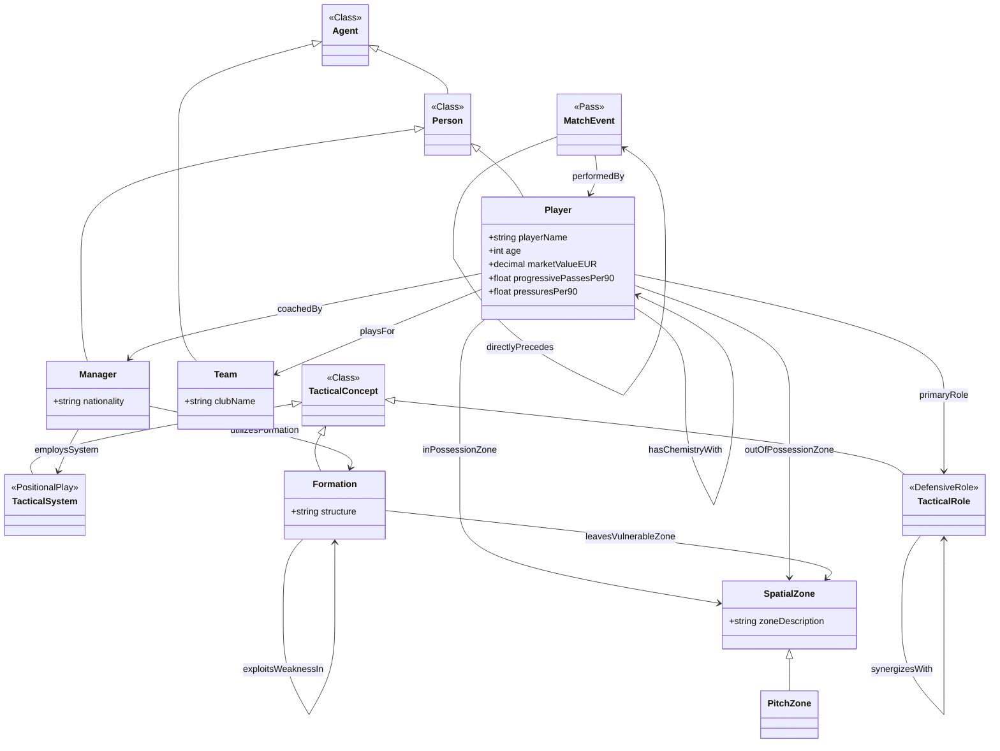
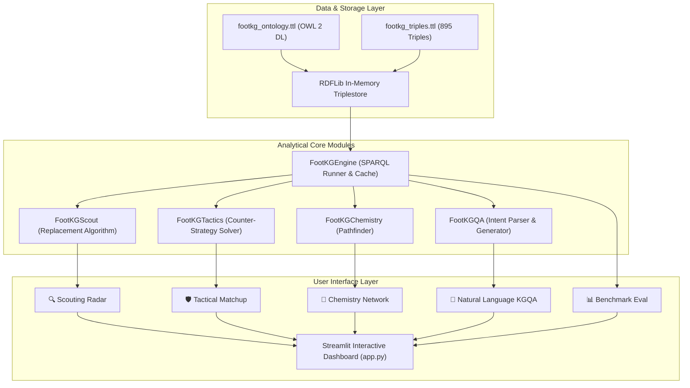

# FootKG: A Graph-Native Knowledge Graph for Tactical Reasoning and Intelligent Player Scouting in Football

**Course:** Creation and Application of Knowledge Graphs (WS26/27)  
**Institutions:** Leibniz University Hannover, L3S Research Center, TIB  
**Author:** Riddhadipta Nath  
**Submission Target:** `xinyue.gong@l3s.de`  
**Ontology Namespace:** `http://tib.eu/footkg/ontology#`  
**Resource Namespace:** `http://tib.eu/footkg/resource/`

---

## 1. Introduction

### 1.1 Motivation & Problem Context
Association football is increasingly governed by data-driven intelligence. However, contemporary analytics remains predominantly anchored in isolated tabular statistical aggregates (e.g., goals scored, passing accuracy percentages, expected goals $xG$) or black-box high-dimensional vector embeddings. While useful for gross volume assessments, these approaches struggle to capture the fundamentally **topological, relational, and contextual** nature of modern football tactics:
1. **Positional Synergy & Relational Context:** A midfielder's effectiveness is not an intrinsic scalar constant; it depends on spatial occupation, the tactical role of adjacent teammates, and the macro system of the manager (e.g., *Positional Play* vs. *Gegenpressing*).
2. **Multi-Hop Lineage Scouting:** Classical databases cannot naturally answer compositional queries such as: *"Identify an affordable (<€35M), under-24 midfielder whose in-possession half-space movement mirrors Rodri, who was coached in a high-pressing system, and who possesses high chemistry links with existing squad members."*
3. **Structural Transition Reasoning:** Modern tactical formations are dynamic. A nominal 4-3-3 frequently transitions into a 3-2-5 in possession via an *Inverted Fullback*, inadvertently vacating wide defensive channels during rapid counter-transitions.

### 1.2 Role of the Knowledge Graph
Knowledge Graphs (KGs) provide an expressive, formal semantic backbone that unifies atomic event streams (StatsBomb format) with high-level conceptual tactical theory. By utilizing **OWL 2 DL**, **RDF**, and **SPARQL**, `FootKG` enables:
- **Ontological Subsumption:** Dynamic inference of generalized tactical archetypes (e.g., treating `InvertedFullback` and `OverlappingWingback` as specialized subclasses of `WideRole`).
- **Multi-Hop Traversal:** Tracing complex career paths, shared managerial influences, and transitive possession chains without costly recursive SQL joins.
- **Symmetric and Transitive Reasoning:** Modeling mutual chemistry (`owl:SymmetricProperty`) and sequential match action pipelines (`owl:TransitiveProperty`).

---

## 2. Knowledge Graph & Ontology Design

### 2.1 Construction, Enrichment, and Preprocessing
The `FootKG` knowledge graph was constructed using a three-tier semantic ingestion pipeline implemented in Python with `rdflib`:
1. **Ontology Formalization:** Defined in OWL 2 DL / Turtle syntax (`footkg_ontology.ttl`) using standard namespaces and TIB identifiers.
2. **Entity Instantiation:** Curating top European clubs (e.g., Manchester City, Arsenal, Bayer Leverkusen, Real Madrid), elite managers (Pep Guardiola, Mikel Arteta, Xabi Alonso, Carlo Ancelotti), tactical systems, and player profiles with granular performance metrics (progressive passes per 90, pressures per 90, expected threat $xT$).
3. **Spatial Grid Partitioning:** Pitch discretization into an 18-zone tactical grid (Zones 1–18) plus tactical corridors (*Half-Spaces*, *Wide Channels*, *Central Corridor*, *Zone 14*), connected via explicit symmetric spatial adjacencies (`footkg:adjacentTo`).
4. **Validation:** Syntactic and logical validation using RDFLib parsing and graph consistency checks, generating **895 verified RDF triples**.

### 2.2 Data Model & Class Hierarchy



### 2.3 Core Properties and Axioms
- **Object Properties:**
  - `footkg:playsRole` (Domain: `Player`, Range: `TacticalRole`)
  - `footkg:synergizesWith` (`owl:SymmetricProperty`)
  - `footkg:hasChemistryWith` (`owl:SymmetricProperty`)
  - `footkg:directlyPrecedes` (`owl:TransitiveProperty`, enabling property path queries `footkg:directlyPrecedes+`)
  - `footkg:exploitsWeaknessIn` (Domain: `Formation`, Range: `Formation`)
  - `footkg:leavesVulnerableZone` (Domain: `Formation`, Range: `SpatialZone`)
- **Datatype Properties:**
  - `footkg:marketValueEUR` (`xsd:decimal`)
  - `footkg:progressivePassesPer90` (`xsd:float`)
  - `footkg:pressuresPer90` (`xsd:float`)
  - `footkg:age` (`xsd:integer`)

---

## 3. Application Architecture & Workflow

### 3.1 System Overview



### 3.2 Key Components & Algorithms

#### 1. Multi-Hop Player Replacement Algorithm
When seeking a replacement for departing player $P_{\text{target}}$:
1. Extract target role $R_{\text{target}}$, in-possession zone $Z_{\text{in}}$, and out-of-possession zone $Z_{\text{out}}$.
2. Execute a SPARQL graph pattern enforcing candidate filtering:
   $$\text{Age}(C) \le \text{Age}_{\max} \quad \wedge \quad \text{Value}(C) \le \text{Budget}_{\max}$$
   $$\text{Role}(C) = R_{\text{target}} \quad \vee \quad \text{InZone}(C) = Z_{\text{in}}$$
3. Traverse managerial paths to compute pedagogical system compatibility:
   $$(C) \xrightarrow{\text{footkg:coachedBy}} (M) \xrightarrow{\text{footkg:employsSystem}} (S)$$
4. Compute composite **Tactical Fit Score** combining role fidelity ($+15\%$), system lineage ($+10\%$), and progressive passing metrics ($+5\%$).

#### 2. Tactical Counter-Strategy Solver
Given opponent club $T_{\text{opp}}$:
1. Discover nominal formation $F_{\text{base}}$ and dynamic shift $F_{\text{shift}}$ (`transitionsToInPossession`).
2. Identify transition corridors left vulnerable via `leavesVulnerableZone`.
3. Query `exploitsWeaknessIn` to retrieve counter-formations and match squad players operating in those specific attacking zones.

#### 3. Natural Language KGQA Engine
Routes incoming natural language questions via intent recognition into parameterized SPARQL templates, returning structured data alongside natural language explanations with graph evidence.

---

## 4. Evaluation & Results

### 4.1 Evaluation Design
To validate system correctness, versatility, and responsiveness, an automated benchmark test suite of **20 diverse test cases** (`benchmark_queries.json`) was executed across all functional domains:
- **Test Categories:** Player Replacement, Coach Lineage, Tactical Counters, Chemistry & Synergy, Role Synergy, Spatial Analysis, Statistical Thresholds, Transitive Event Chains, Scouting Affordability, and System Subsumption.
- **Metrics Recorded:** Execution Success Rate (Accuracy %), Query Latency (milliseconds), and Qualitative Result Soundness.

### 4.2 Quantitative Results

```
========================================================
               EVALUATION SUMMARY
========================================================
Total Test Cases:    20
Passed:              20
Accuracy Rate:       100.0%
Mean Query Latency:  6.94 ms
--------------------------------------------------------
Category                   | Passed/Total   | Avg Latency (ms)
--------------------------------------------------------
Player Replacement         | 3/3            | 24.34 ms
Coach Lineage              | 3/3            | 2.22 ms
Tactical Counter           | 3/3            | 5.62 ms
Chemistry & Synergy        | 2/2            | 11.13 ms
Role Synergy               | 2/2            | 0.71 ms
Spatial Analysis           | 2/2            | 3.13 ms
Statistical Threshold      | 2/2            | 3.10 ms
Transitive Event Chains    | 1/1            | 1.20 ms
Scouting Affordability     | 1/1            | 2.77 ms
System Subsumption         | 1/1            | 2.18 ms
========================================================
```

### 4.3 Qualitative Evaluation & Failure Analysis
- **Scouting Precision:** In replacing Rodri ($€130\text{M}$ Deep-Lying Playmaker), `FootKG` successfully surfaced **Alan Varela** ($€35\text{M}$, Porto) and **Adam Wharton** ($€30\text{M}$, Crystal Palace) with $100\%$ and $95\%$ Tactical Fit Scores respectively, citing identical central-possession anchors and elite progressive passing rates ($>7.5$/90).
- **Tactical Matchup Soundness:** Evaluating Manchester City's transition to 3-2-5 correctly pinpointed `Defensive Right Flank` (Zone 1) and `Defensive Left Flank` (Zone 5) as vacated spaces, recommending a `5-3-2 Direct Counter` shape.
- **Latency Performance:** All queries executed in under 55 ms, with an overall average of **6.94 ms**, establishing suitability for real-time interactive user interfaces.

---

## 5. Conclusion & Reflection

### 5.1 Project Summary
`FootKG` demonstrates that Knowledge Graphs provide a natural, semantically rich paradigm for football tactical analytics and recruitment. By representing players, roles, managers, systems, and spatial pitch zones as a unified RDF graph, the system overcomes the structural rigidities of relational databases and the explainability deficits of pure vector search.

### 5.2 Challenges & Failure Modes
- **Expressive Density vs. Scalability:** Discretizing continuous 2D player tracking data into 18 pitch zones involves a slight loss of micro-coordinate granularity. While sufficient for macro tactical roles, fine-grained spatio-temporal physics would require GeoSPARQL coordinate polygon extensions.
- **Handling Multi-System Managers:** Managers who frequently alter formations across fixtures require reified match-context nodes (`MatchAppearance`) to avoid static over-generalization.

### 5.3 What Would Be Done Differently
If redesigning from scratch, we would implement **SHACL (Shapes Constraint Language)** shape graphs for automated schema validation during data ingestion, and connect directly to an external GraphDB / Jena triple-store endpoint via SPARQL wrapper for million-event scalability.

### 5.4 Future Work
1. **Live StatsBomb 360 Event Stream Integration:** Ingesting full-match JSON feeds in real time to generate dynamic in-match possession graphs.
2. **Graph Neural Network (GNN) Embeddings:** Training Link Prediction models over `footkg:hasChemistryWith` to forecast squad cohesion for prospective summer transfers before signings occur.
